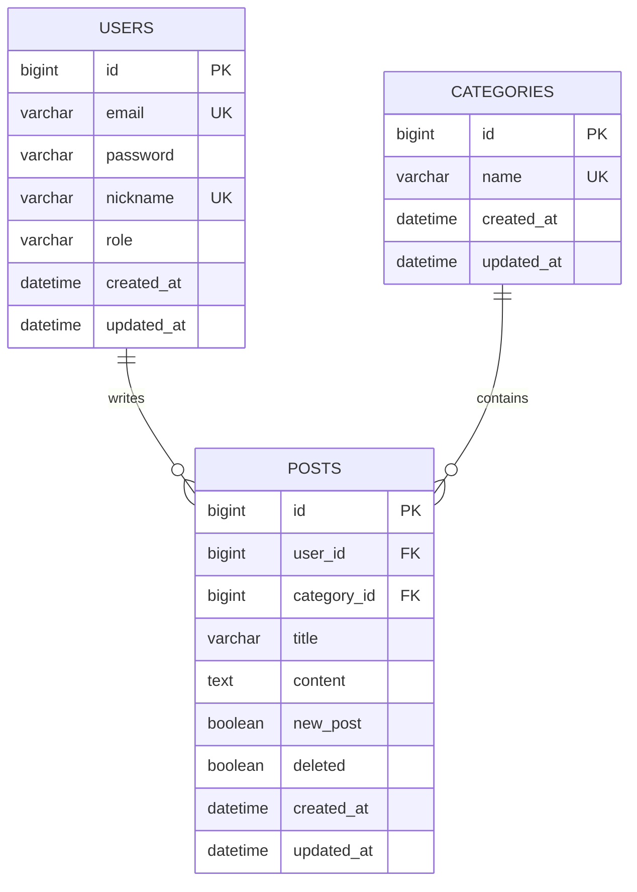

# AskTeacher

[](https://codecov.io/gh/marcel615/Ask-Teacher)

AskTeacher는 사용자가 질문 게시글을 작성하고 조회할 수 있는 Q&A 기반 백엔드 API 프로젝트입니다.

회원가입, 로그인, 카테고리 조회와 게시글 작성/목록/상세/수정/삭제 기능을 제공하며, 보호된 요청은 JWT 기반으로 인증합니다.

## 기술 스택

| 구분 | 기술 |
|---|---|
| Language | Java 17 |
| Framework | Spring Boot 4.0.6 |
| Web | Spring WebMVC |
| ORM | Spring Data JPA |
| Security | Spring Security, BCrypt |
| Validation | Jakarta Validation |
| Database | H2, MySQL Connector |
| Test | JUnit 5, Spring Boot Test, AssertJ |
| Build Tool | Gradle |
| 기타 | Lombok |

## 주요 기능

### 인증

- 회원가입
  - 이메일, 비밀번호, 닉네임 입력
  - 이메일/닉네임 중복 검증
  - 비밀번호 BCrypt 암호화 저장
- 로그인
  - 이메일/비밀번호 검증
  - 로그인 성공 시 JWT 액세스 토큰과 토큰 타입 `Bearer` 반환
- 인증이 필요한 요청은 `Authorization: Bearer <token>` 헤더 사용
- 회원가입·로그인과 카테고리, 게시글, 게시글 댓글 및 파일 조회는 공개하며 그 외 요청에는 인증 필요

### 카테고리

- 카테고리 목록 조회
- 애플리케이션 실행 시 기본 카테고리 자동 생성
  - Java
  - Spring
  - Database
  - Git
  - 기타

### 게시글

- 게시글 작성
  - 인증된 사용자와 카테고리 ID, 제목, 내용 기반 생성
  - 새 게시글은 `newPost = true`, `deleted = false`로 생성
- 게시글 목록 조회
  - 삭제되지 않은 게시글만 조회
  - `createdAt` 기준 내림차순 정렬
- 게시글 상세 조회
  - 작성자명, 카테고리명, 제목, 내용, 생성일 조회
- 게시글 수정
  - 인증된 사용자 ID와 게시글 작성자 ID를 비교해 작성자 검증
  - 카테고리, 제목, 내용 수정
  - JPA Dirty Checking으로 변경 반영
- 게시글 삭제
  - 인증된 사용자 ID와 게시글 작성자 ID를 비교해 작성자 검증
  - 물리 삭제가 아닌 Soft Delete 방식
  - `deleted = true`로 변경
  - 이미 삭제된 게시글은 조회되지 않는 게시글과 동일하게 처리

## 프로젝트 구조

```text
src/main/java/com/github/marcel615/askteacher
├── domain
│   ├── auth
│   │   ├── controller
│   │   ├── dto
│   │   └── service
│   ├── category
│   │   ├── controller
│   │   ├── dto
│   │   ├── entity
│   │   ├── repository
│   │   └── service
│   ├── post
│   │   ├── controller
│   │   ├── dto
│   │   ├── entity
│   │   ├── repository
│   │   └── service
│   └── user
│       ├── entity
│       ├── repository
│       └── type
├── global
│   ├── config
│   ├── exception
│   ├── init
│   └── response
└── http
    ├── auth
    ├── category
    └── post
```

## ERD



## API 명세

공통 성공 응답 형식:

```json
{
  "status": 200,
  "message": "요청에 성공했습니다.",
  "data": {}
}
```

공통 에러 응답 형식:

```json
{
  "status": 400,
  "message": "에러 메시지"
}
```

| 기능 | Method | URL | 설명 |
|---|---|---|---|
| 회원가입 | POST | `/api/auth/signup` | 사용자 생성 |
| 로그인 | POST | `/api/auth/login` | 이메일/비밀번호 로그인 |
| 카테고리 목록 조회 | GET | `/api/categories` | 게시글 카테고리 목록 조회 |
| 게시글 작성 | POST | `/api/posts` | 질문 게시글 생성 |
| 게시글 목록 조회 | GET | `/api/posts` | 삭제되지 않은 게시글 목록 조회 |
| 게시글 상세 조회 | GET | `/api/posts/{postId}` | 게시글 상세 정보 조회 |
| 게시글 수정 | PATCH | `/api/posts/{postId}` | 작성자 검증 후 게시글 수정 |
| 게시글 삭제 | DELETE | `/api/posts/{postId}` | 게시글 soft delete |

자세한 API 요청/응답 예시는 [`docs/api-spec.md`](docs/api-spec.md)를 참고합니다.

## 실행 방법

### 사전 준비

- Java 17
- Gradle Wrapper 사용

### 애플리케이션 실행

Windows:

```bash
./gradlew.bat bootRun
```

macOS/Linux:

```bash
./gradlew bootRun
```

기본 실행 주소:

```text
http://localhost:8080
```

### H2 Console

```text
URL: http://localhost:8080/h2-console
JDBC URL: jdbc:h2:mem:askteacher
Username: sa
Password:
```

### 테스트 실행

Windows:

```bash
./gradlew.bat test
```

macOS/Linux:

```bash
./gradlew test
```

### API 자동 테스트

`src/test/java/com/github/marcel615/askteacher`에서 Controller, Service, Repository 및 API 통합 테스트를 관리합니다.
새 API 또는 변경된 API에는 관련 계층 테스트와 통합 테스트를 작성하고 위 Gradle 명령으로 실행합니다.
테스트는 `test` 프로필의 H2 메모리 DB와 테스트 전용 JWT 설정을 사용하며, 실제 첨부파일은 임시 디렉터리에 저장하고 정리합니다.
서블릿 업로드 제한은 테스트가 시작하는 임의 포트 HTTP 서버로 검증하므로 수동 서버 기동이 필요하지 않습니다.
테스트 범위·실행 결과·미검증 사항은 `docs/current-work-log.md`와 PR 요약 또는 devlog에 기록합니다.
H2 검증은 MySQL 고유 동작 검증을 대체하지 않습니다.

## AI-DLC 작업 방법

이 저장소는 Issue 하나를 기준으로 Main Codex와 역할별 Subagent가 개발을 진행하는 절차를 설정해 두었습니다. 사용자는 PM이자 최종 승인자입니다. Codex에게 다음과 같이 자연어로 요청할 수 있습니다.

- 다음 Issue 선정부터 시작: `작업 시작해. 다음 Issue를 확인해줘.`
- 특정 Issue 시작: `Issue #번호 작업 시작해.`
- 머지 후 정리: `PR 머지했어. 확인 후 develop 최신화와 브랜치 정리를 진행해.`

이 문구는 고정된 CLI 명령이 아닌 예시입니다. 더 많은 예시는 [빠른 지시문](docs/prompts/quick.md)을 참고하세요.

### 역할과 진행 순서

| 역할 | 책임 |
|---|---|
| Main | Issue 선정과 단계 조율, 품질 게이트 판단, GitHub 상태 확인과 사용자 보고 |
| Architect | Issue 분석과 설계 문서 작성, 구현 변경의 독립 리뷰 |
| Builder | 승인된 범위의 구현·테스트·수정과 임시 작업 기록 |
| Reporter | Issue와 PR, 작업 기록 및 검증 근거를 확인해 devlog 작성 |

1. Main이 진행 중인 작업과 Issue의 우선순위·선행 관계·사용자 결정을 확인하고 한 Issue를 선정합니다.
2. Architect가 범위와 검증 계획을 설계하고, Main이 품질 게이트를 판단해 승인된 내용을 `docs/current-task.md`에 반영합니다.
3. Builder가 작업 브랜치에서 승인된 범위를 구현하고 테스트합니다. Main이 구현 게이트를 확인한 뒤 PR을 생성합니다.
4. Architect가 독립 리뷰하고 필요한 수정과 재검증을 거칩니다. Reporter가 devlog를 작성합니다. AI 리뷰는 팀의 필수 사람 리뷰를 대신하지 않습니다.
5. Main이 최종 push의 head 기준으로 CI, 필수 리뷰·브랜치 보호 조건, 충돌과 devlog를 확인합니다. 조건이 충족되면 **사용자가 직접 PR을 머지**합니다.
6. 사용자가 머지를 알리면 Main이 실제 머지와 미반영 변경을 확인하고 `develop` 최신화 및 안전한 브랜치 정리를 진행합니다.

요구사항이 불명확하거나 범위 확대, DB 구조·인증·인가 또는 중요 설정 변경, 위험 작업이나 필수 승인이 필요한 경우에는 작업을 중단하고 사용자에게 확인합니다. 테스트·CI·리뷰 문제를 정해진 한도 안에 해결하지 못하거나 상태를 확인할 수 없는 경우에도 중단해 보고합니다.

### 지침과 현재 상태

- [AGENTS.md](AGENTS.md): 권한, 브랜치, 테스트와 기록 규칙
- [Issue 기반 개발 절차](.agents/skills/issue-driven-dev/SKILL.md): 선정 기준, 품질 게이트, 리뷰와 재개 절차
- [역할 설정](.codex/agents/): Architect, Builder, Reporter 설정
- [현재 작업 설계](docs/current-task.md), [임시 작업 기록](docs/current-work-log.md), [devlog](docs/devlog/): 작업 범위와 검증 기록
- [기능 아이디어](docs/feature-ideas.md): 사용자 승인 여부와 후속 후보 관리

위 내용은 저장소에 설정된 절차를 설명합니다. 각 실행의 테스트·CI·리뷰 성공 여부는 해당 작업에서 별도로 확인해야 합니다. [GitHub Projects](https://github.com/users/marcel615/projects/1) 기반 운영을 도입 중이며 자동 상태 전환의 실제 동작과 전체 연동은 통합 검증 전입니다. Jira 연동은 구현되어 있지 않습니다.

## 트러블슈팅

### 로그인 사용자 조회 로직 개선

초기 로그인 로직은 이메일 존재 여부 확인과 사용자 조회를 분리해 같은 조건의 DB 조회가 두 번 발생했습니다. 이를 `findByEmail()` 한 번으로 조회하고, `Optional<User>.orElseThrow()`로 예외 처리를 함께 수행하도록 개선했습니다.

그 결과 DB 접근이 줄고, "사용자가 없을 수 있다"는 의도가 코드에 더 명확하게 드러났습니다.

### Soft Delete 처리

게시글 삭제는 DB row를 제거하지 않고 `deleted = true`로 변경합니다. 목록 조회와 삭제 대상 조회에서는 삭제된 게시글을 제외해 사용자 입장에서는 존재하지 않는 게시글처럼 처리합니다.

### 인증과 작성자 검증

JWT 필터는 유효한 Bearer 토큰의 사용자 ID를 인증 주체로 설정합니다. 게시글 작성은 이 사용자 ID를 사용하고, 수정과 삭제는 인증된 사용자 ID와 게시글 작성자 ID를 비교합니다. 인증이 필요한 요청에 토큰이 없거나 유효하지 않으면 401, 다른 작성자의 게시글을 수정하거나 삭제하면 403을 반환합니다.

## 배운 점

- Issue 단위로 요구사항, API 명세, ERD, 구현 범위를 먼저 정리하면 기능 범위가 커지는 것을 막을 수 있었다.
- Spring Data JPA 메서드 네이밍만으로 삭제 제외 및 생성일 내림차순 조회를 간결하게 구현할 수 있었다.
- 게시글 수정은 별도 update query 없이 JPA Dirty Checking으로 처리할 수 있었다.
- Soft Delete를 적용할 때는 삭제 로직뿐 아니라 목록 조회, 상세 조회, 재삭제 처리 정책까지 함께 정해야 한다는 점을 확인했다.
- 인증된 사용자와 게시글 작성자를 비교해 수정·삭제 권한을 검증하는 것이 중요했다.

## 향후 개선 사항

- 댓글 CRUD
- 게시글 검색 및 페이징
- Controller/WebMvc 테스트 보강
- 배포 환경 구성
